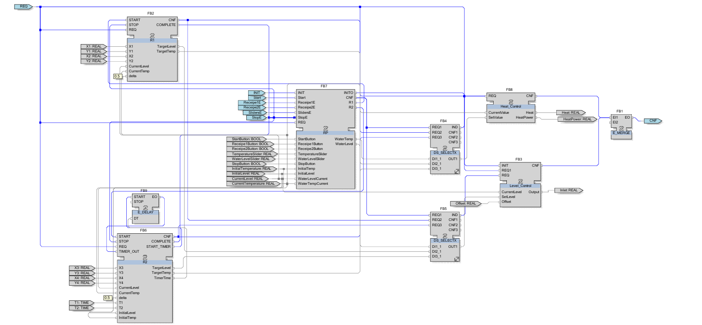
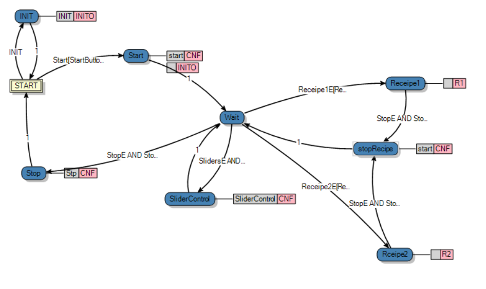
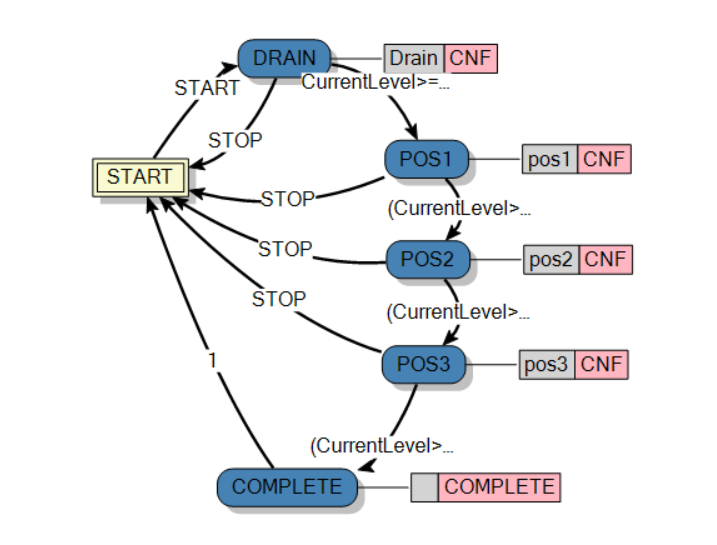
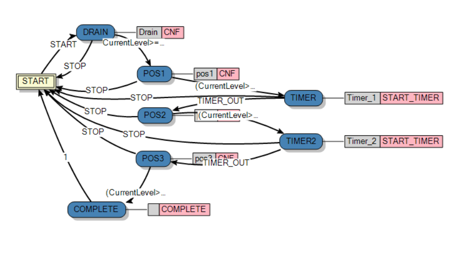
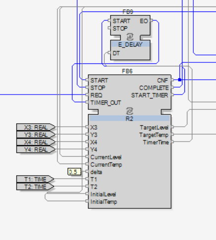
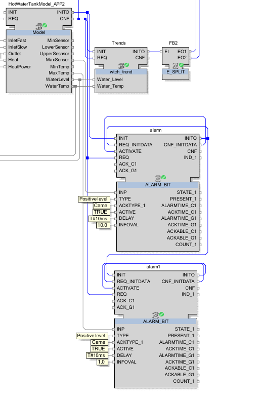

# Technical Documentation: Control System

## 1. System Requirements

### 1.1 Initial Conditions Requirements
* **IR-01**: The initial temperature must be set to INITIAL TEMPERATURE.
* **IR-02**: The initial level must be set to INITIAL LEVEL.

### 1.2 Recipe Requirements
* **RR-01**: Only one product recipe can be selected and executed at a time.
* **RR-02**: If a new recipe is selected while another is already executing, the system must ignore new recipe.
* **RR-03**: Manual controls are strictly ignored during automatic production.
* **RR-04**: At the beginning of every recipe, water must be drained.

### 1.3 Control Requirements
* **CR-01**: The next recipe and manual controls should only become available after the previous task is successfully completed or stopped.
* **CR-02**: When Stop pressed, recipe should stop and go to initial parameters.

### 1.4 Alarm Requirements
* **AR-01**: If temperature reaches max defined value, system should raise alarm.
* **AR-02**: If water level reaches max defined value, system should raise alarm.

---

## 2. Controller Architecture

The control system is structured into a multi-layered architecture:

* **Presentation Layer**: Controls sequence of actions in recipes.
* **Process Layer**: Manages the core logic of the system, determining the active states of recipes and monitoring current sensor values against target values.
* **User-defined Layer**: Contains specialized function blocks (e.g., Heat_Control, Level_Control) that execute the physical actuation (inlets, heat power) based on the process layer's requests.

### 2.1 Recipe Execution State Machines

The system uses function blocks to control the sequence of actions for two distinct recipes:

**First Recipe Block**: Uses a state machine transitioning from START to DRAIN, and then through sequential positions (POS1, POS2, POS3) before reaching COMPLETE. Transitions rely on conditions checking if the current level and temperature are near their target values within a specified range (delta).

**Second Recipe Block**: Similar to the first, but introduces specific timer implementations (TIMER, TIMER2) that delay the transition between certain states, outputting START_TIMER signals when active.

---

## 3. Alarm Handling Implementation

Effective alarm handling is critical for operational safety and system integrity. Based on the system constraints, the alarm handling strategy is defined as follows:

### 3.1 Defined Alarms
* **Max Temperature Alarm**: When the max temperature sensor is triggered, the system activates an alarm. The operator must check the working conditions and acknowledge the alarm to clear it.
* **Max Level Alarm**: When the max level sensor is triggered, an alarm activates, requiring the operator to inspect the tank and acknowledge the state.

### 3.2 Implementation Logic

The alarm system is implemented using ALARM_BIT function blocks that monitor the positive level edges of the sensor triggers.

---

## 4. Requirement Coverage Table

| Requirement ID | Requirement Summary | Design Evidence |
| :--- | :--- | :--- |
| **IR-01** | The initial temperature must be set to INITIAL TEMPERATURE. | Start state in RP block |
| **IR-02** | The initial level must be set to INITIAL LEVEL. | Start state in RP block |
| **RR-01** | Only one product recipe can be selected and executed at a time. | RP state machine transition conditions |
| **RR-02** | If a new recipe is selected while another is already executing, the system must ignore new recipe. | RP state machine transition conditions |
| **RR-03** | Manual controls are strictly ignored during automatic production. | RP state machine transition conditions |
| **RR-04** | At the beginning of every recipe, water must be drained. | Recipe Execution State Machines (transition to DRAIN state). |
| **CR-01** | The next recipe and manual controls should only become available after the previous task is successfully completed or stopped. | RP state machine transition conditions |
| **CR-02** | When Stop pressed, recipe should stop and go to initial parameters. | RP StopRecipe state |
| **AR-01** | If temperature reaches max defined value, system should raise alarm. | ALARM_BIT function blocks. |
| **AR-02** | If water level reaches max defined value, system should raise alarm. | ALARM_BIT function blocks. |
