# Simulated MPS Distribution Station Control

## Overview

This project implements an industrial automation control system for a simulated Modular Production System (MPS) Distribution Station based on the **IEC 61499** standard and the **IMC (Interface-Model-Controller / Interpreted Model Control)** architectural pattern. 

The primary purpose of the station is to store raw cylindrical workpieces and sequentially transfer them to downstream manufacturing stations.

---

## System Architecture & Subsystems

The station consists of two core physical/functional subsystems that execute coordinated, event-driven control sequences:

1. **Stack Magazine Subsystem**
   - **Function:** Stores raw workpieces in a vertical column and dispenses them one by one via a pneumatic pushing cylinder.
   - **Sensors & Actuators:** Workpiece empty sensor, cylinder retracted limit sensor (`pos_r`), cylinder extended limit sensor (`pos_e`), pneumatic cylinder extend/retract actuator.

2. **Transfer Unit Subsystem (Arm Transport)**
   - **Function:** Picks up the dispensed workpiece at the magazine handover point using a vacuum suction gripper and swings to transfer it to the downstream station handover point.
   - **Sensors & Actuators:** Arm position sensors (`at_mgz`, `at_next`), vacuum switch monitor sensor (`v_mon`), rotary arm motor/actuator commands (`to_mgz`, `to_next`), vacuum generator commands (`vcm_on`, `vcm_off`).

---

## Requirements Specification

### General Requirements
- **GR-01:** The station must support operation in both **MANUAL** and **AUTOMATIC** modes.

### Initial State Requirements
- **IR-01:** In the initial state, the Stack Magazine cylinder must be fully retracted.
- **IR-02:** In the initial state, the Transfer Unit arm must reside at the magazine pickup position with vacuum turned off.
- **IR-03:** After system power-up/initial boot (`INIT`), the station automatically navigates to the initial position.

### Automatic Mode Requirements
- **AMR-01:** When both Stack Magazine and Transfer Unit are in their initial positions, the system indicates readiness by illuminating the **Start** button LED.
- **AMR-02:** Pressing the **Start** button starts or resumes the automatic production cycle.
- **AMR-03:** When **Stop** is pressed, the station completes the current motion to a safe, stable state before halting cycle execution.
- **AMR-04:** When stopped, pressing **Reset** returns the station and button indications to the initial state.
- **AMR-05:** When the Stack Magazine is not empty, the **Acknowledge (ACK)** button LED remains continuously on.
- **AMR-06:** When the Stack Magazine runs empty, the **Acknowledge (ACK)** button LED flashes/blinks.
- **AMR-07:** The **Acknowledge (ACK)** LED stops blinking once an operator presses the ACK button.

### Component-Specific Requirements
- **MR-01 (Stack Magazine):** If the magazine empty sensor remains triggered for longer than 1.5 seconds, the stack empty indication (ACK blinking) activates.
- **TR-01 (Transfer Unit):** Vacuum grip must remain energized without interruption during part transit between stable points.

### Manual Mode Requirements
- **MMR-01:** Activating `Push WP` extends the magazine cylinder.
- **MMR-02:** Deactivating `Push WP` retracts the magazine cylinder.
- **MMR-03:** Activating `GO TO MAG` drives the arm toward the magazine position.
- **MMR-04:** Activating `GO TO NEXT` drives the arm toward the downstream station position.
- **MMR-05:** Activating both `GO TO MAG` and `GO TO NEXT` concurrently stops arm motion.
- **MMR-06:** Activating `Vacuum ON` turns the vacuum suction on.
- **MMR-07:** Activating `Vacuum OFF` turns the vacuum suction off.
- **MMR-08:** Activating both `Vacuum ON` and `Vacuum OFF` concurrently disables the vacuum.

---

## Logical Design & Workflows

The Stack Magazine and Transfer Arm operate independently and concurrently, coordinated via synchronization events and supervisory interlocks.

### 1. Stack Magazine Subsystem

The magazine controller boots into `SETUP`, retracting the cylinder until `pos_r` is verified. In `AUTOMATIC` mode, it advances through four cyclical states: `EXTEND`, `EXTENDED` (stable state), `RETRACT`, and `RETRACTED` (stable state).

| State Machine Diagram | Operational Workflow |
| :---: | :---: |
|  | 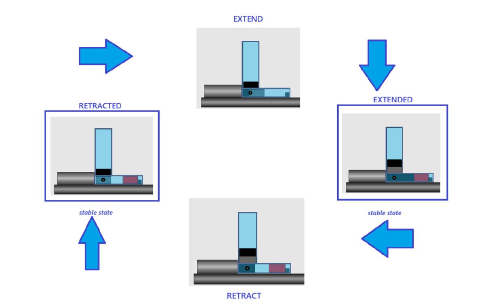 |
| *Figure 1: Magazine State Diagram* | *Figure 2: Automatic Dispensing Sequence* |

---

### 2. Arm Transfer Subsystem

The transfer unit boots into `SETUP` to swing the arm back to the magazine position (`at_mgz`). The automatic pick-and-place sequence runs across four primary states: `PICK_UP` (stable state), `PICKED_UP`, `PUT_DOWN` (stable state), and `TO_MAGAZINE`.

| State Machine Diagram | Operational Workflow |
| :---: | :---: |
|  | 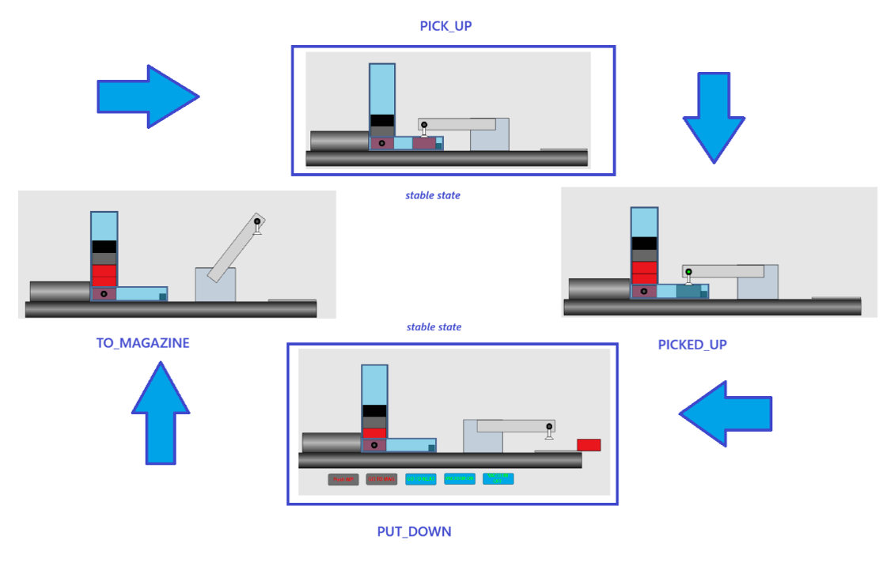 |
| *Figure 3: Arm Transfer State Diagram* | *Figure 4: Automatic Pick-and-Place Sequence* |

---

## Software Implementation

The control software is structured using the **Interpreted Model Control (IMC)** architecture:
- **HMI:** Test panel and operator pushbuttons.
- **Control:** Subsystem-specific execution control charts (ECC) and composite function blocks (`ARM_IMC`, `MGZ_IMC`, `Button_IMC`).
- **Supervision:** Mode selection (`MANUAL` vs. `AUTO`), global interlocking, ready signaling, and safe stop handling.
- **Model:** Plant simulation model representing actuators, pneumatic drives, and workpiece dynamics.

### Top-Level Architecture
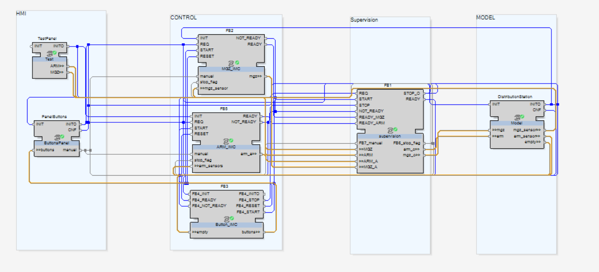
*Figure 5: IEC 61499 Application Architecture*

---

### Transfer Unit Control (`ARM_IMC`)
Encapsulates sensor input evaluation, state machine logic, and actuator signal outputs for rotary arm swing and vacuum gripping.

| Function Block Interconnections | Execution Control Chart (ECC) |
| :---: | :---: |
| 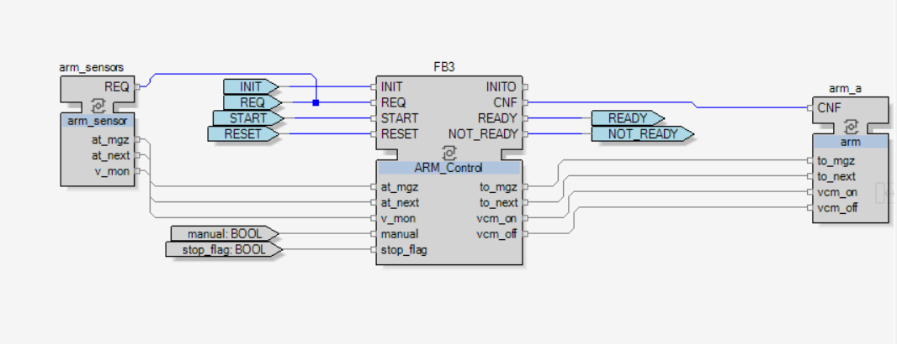 | 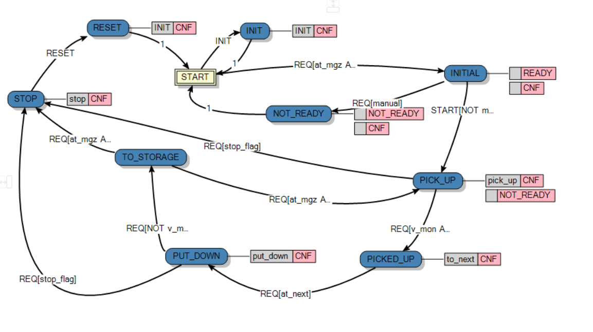 |
| *Figure 6: ARM_IMC Composite Block* | *Figure 7: ARM Control State Machine* |

---

### Stack Magazine Control (`MGZ_IMC`)
Coordinates cylinder extension/retraction timing (`E_DELAY`), limits, and magazine empty monitoring.

| Function Block Interconnections | Execution Control Chart (ECC) |
| :---: | :---: |
| 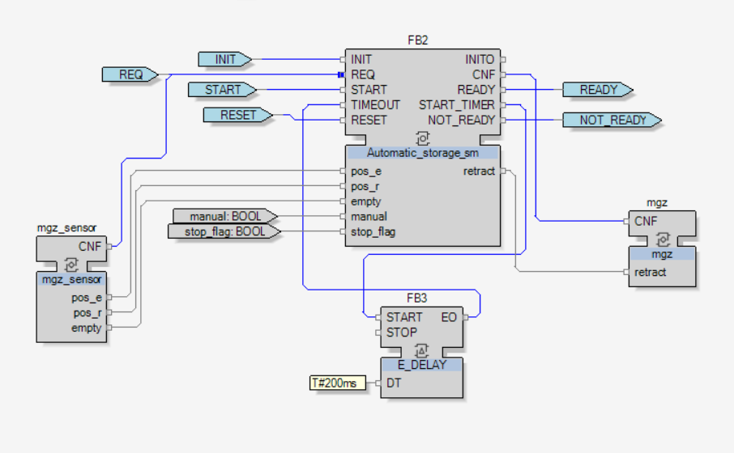 | 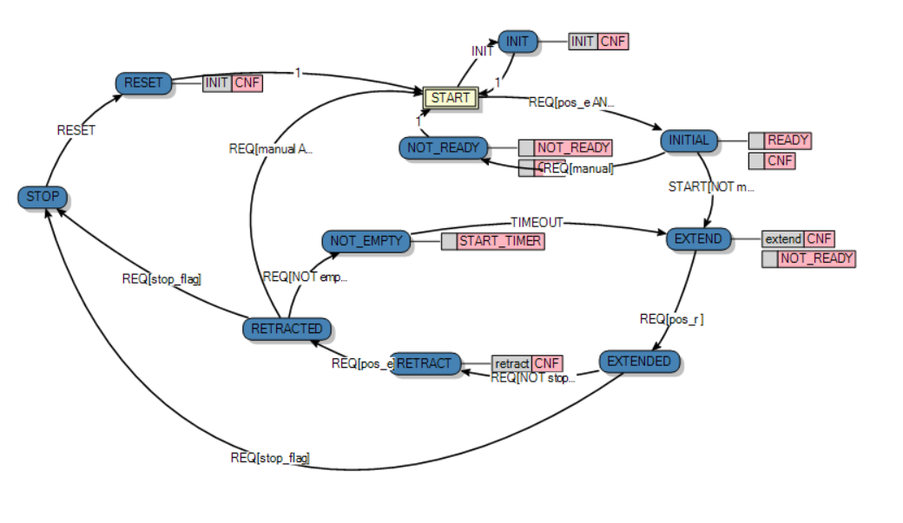 |
| *Figure 8: MGZ_IMC Composite Block* | *Figure 9: Stack Magazine State Machine* |

---

### Button & Operator Panel (`Button_IMC`)
Processes operator button inputs (`START`, `STOP`, `RESET`, `ACK`), drives indicator LEDs, and generates blinking frequency pulses via `E_CYCLE`.

| Block Architecture | Logic Network | State Machine |
| :---: | :---: | :---: |
| 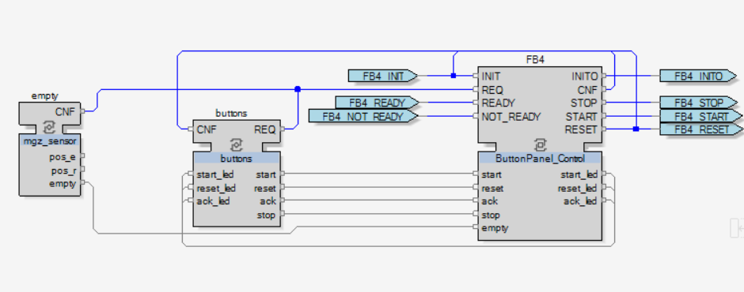 | 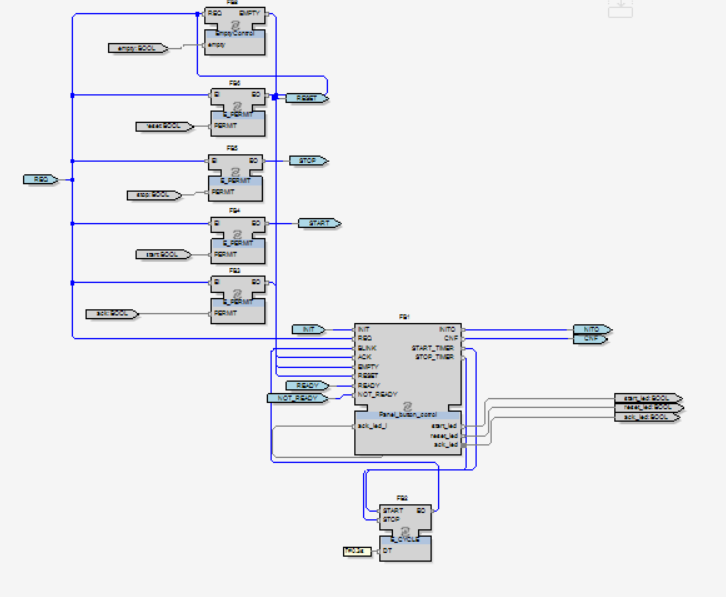 | 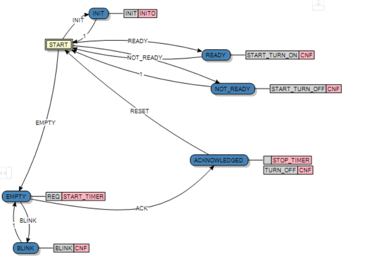 |
| *Figure 10: Button_IMC Block* | *Figure 11: Button Control Implementation* | *Figure 12: Button Panel State Machine* |

---

### Supervision Subsystem
Supervises operating modes, arbitrates manual test overrides, flags asynchronous stop commands, and coordinates rendezvous ready signals (`E_REND`) between subsystems.

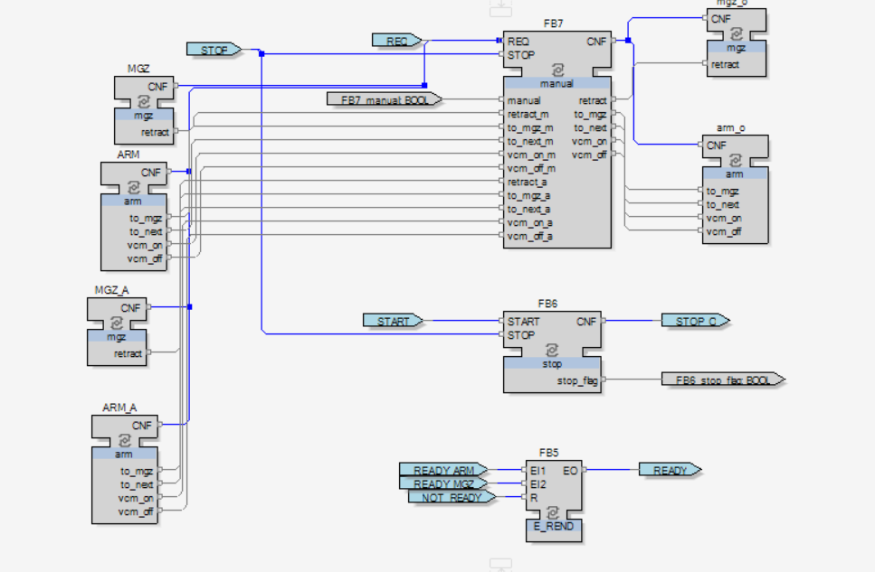
*Figure 13: Supervision Function Block Architecture*

---

## Requirements Traceability Matrix

| Requirement | Description | Implementation Component / Mechanism |
| :--- | :--- | :--- |
| **GR-01** | Manual & Automatic mode selection | `Supervision (FB7 manual)` arbitrates commands between manual test inputs and automated controller outputs. |
| **IR-01** | Stack Magazine initial retracted state | `Automatic_storage_sm` executes `INIT` and transitions to `SETUP` to retract cylinder. |
| **IR-02** | Transfer Unit initial position at magazine | `ARM_Control` executes `INIT` and transitions to `SETUP` to position arm at `at_mgz` with vacuum disabled. |
| **IR-03** | Auto-homing on boot | Station triggers controller `INIT` states upon initial power-up. |
| **AMR-01**| Ready indication (Start LED) | `FB5 (E_REND)` merges `READY_ARM` and `READY_MGZ` events to energize `START` LED. |
| **AMR-02**| Start button execution | In ready condition, operator `START` event triggers automated cycles across control blocks. |
| **AMR-03**| Controlled stop at stable states | `FB6 (stop)` latches `stop_flag`; `Automatic_storage_sm` and `ARM_Control` only transition to `STOP` from predefined stable states. |
| **AMR-04**| Reset command handling | `RESET` event transitions subsystems from `STOP` back to `SETUP` homing. |
| **AMR-05**| Acknowledge LED on when filled | `Panel_button_control` asserts `ack_led` high in initial/steady non-empty states. |
| **AMR-06**| Acknowledge LED blinking on empty | `Panel_button_control` enters `BLINK` state using periodic pulses from `FB2 (E_CYCLE)`. |
| **AMR-07**| Clear ACK blinking on press | Operator pressing `ACK` button transitions logic into `ACKNOWLEDGED` state. |
| **MR-01** | Magazine empty delay threshold (1.5 s) | Filtered detection logic in `EmptyControl` and `Panel_button_control` timers. |
| **TR-01** | Vacuum sustained during transit | `ARM_Control` asserts `vcm_on` throughout transit until downstream release verification (`NOT v_mon`). |
| **MMR-01**| Manual push WP cylinder extend | Routed via `TestPanel` manual controls through `FB7 manual` in manual mode. |
| **MMR-02**| Manual push WP cylinder retract | Cylinder retracts automatically upon releasing `Push WP`. |
| **MMR-03**| Manual drive arm to magazine | Handled via manual override `to_mgz_m` in `FB7 manual`. |
| **MMR-04**| Manual drive arm to next station | Handled via manual override `to_next_m` in `FB7 manual`. |
| **MMR-05**| Arm stops on opposing manual commands | Conflicting arm directional commands evaluate to idle/stop output. |
| **MMR-06**| Manual vacuum activation | Handled via manual override `vcm_on_m` in `FB7 manual`. |
| **MMR-07**| Manual vacuum deactivation | Handled via manual override `vcm_off_m` in `FB7 manual`. |
| **MMR-08**| Conflicting vacuum commands interlock | Vacuum disables if both `vcm_on_m` and `vcm_off_m` are simultaneously energized. |
